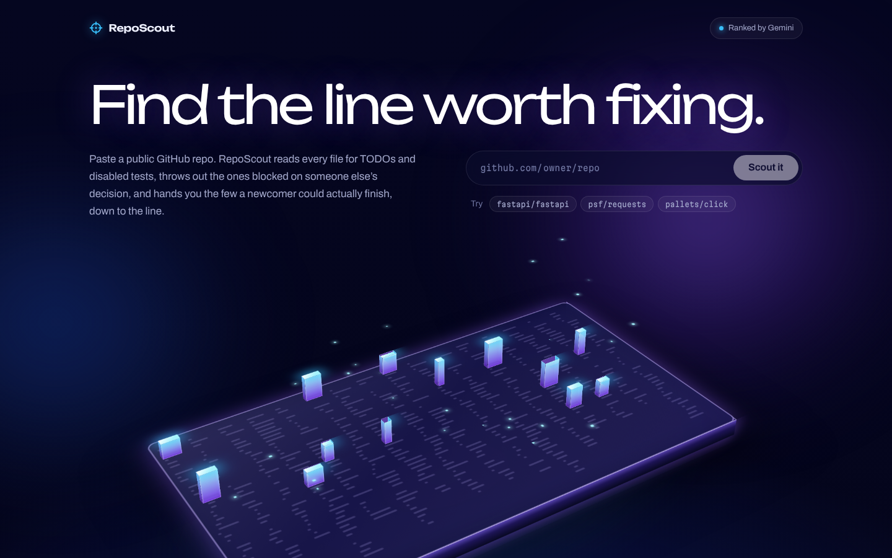
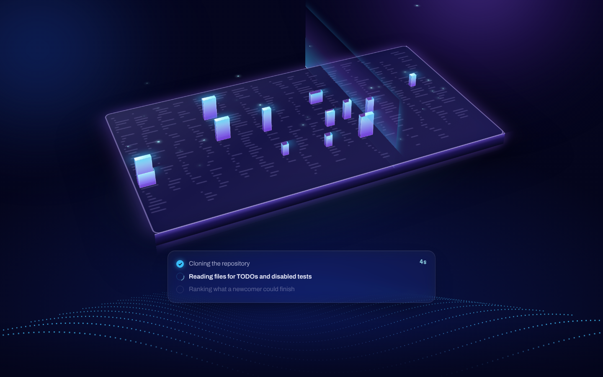
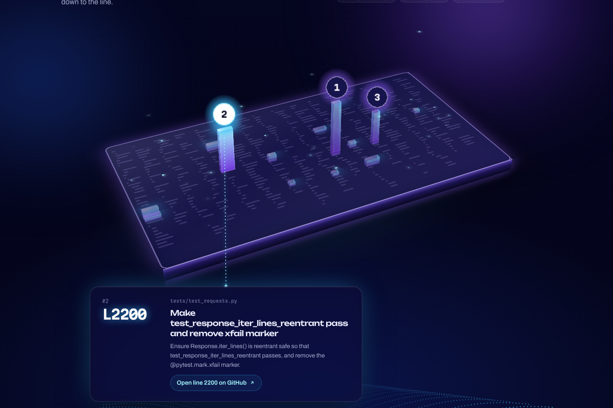
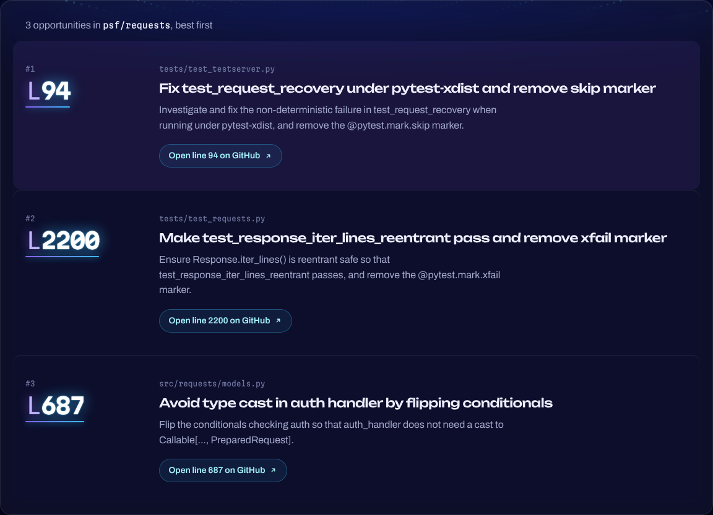
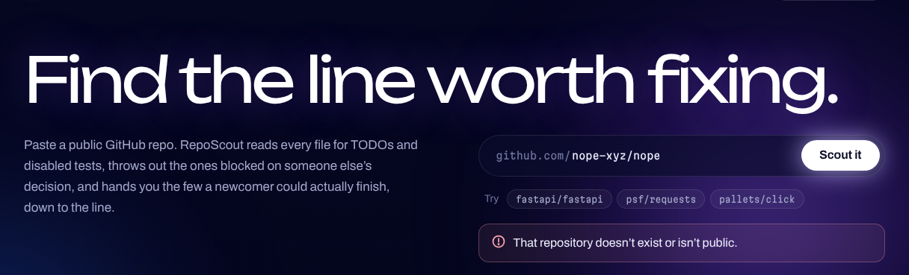
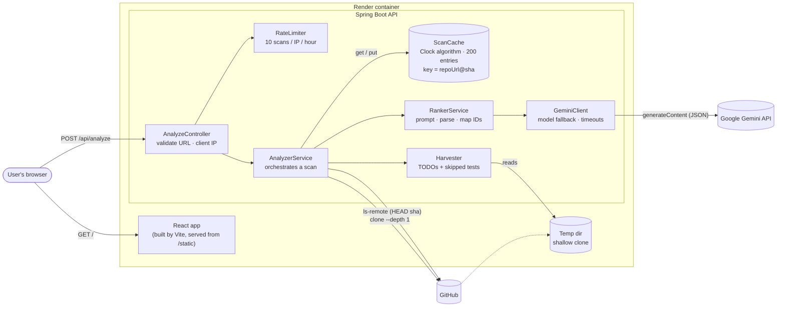
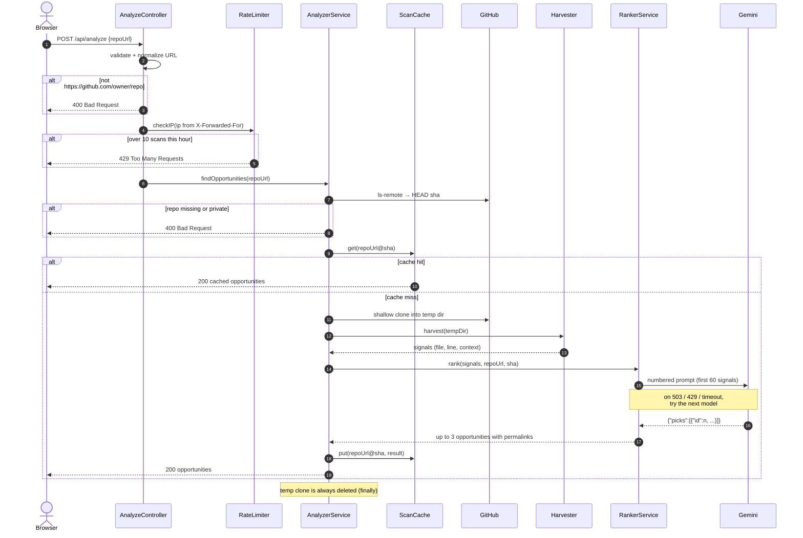
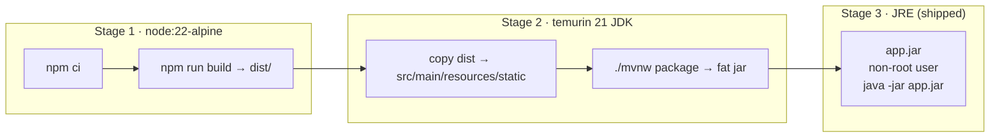

<div align="center">

# RepoScout

**Find the line worth fixing.**

Paste a public GitHub repository. RepoScout reads every file for TODOs and disabled tests, throws out the ones blocked on someone else's decision, and hands you the few a newcomer could actually finish, down to the exact line.

[Live demo](https://reposcout-fiqy.onrender.com) · [How it works](#how-it-works) · [Architecture](#architecture) · [Run it locally](#running-locally)




</div>

---

## Contents

- [Why](#why)
- [What it looks like](#what-it-looks-like)
- [How it works](#how-it-works)
- [Architecture](#architecture)
- [Design decisions](#design-decisions)
- [API](#api)
- [Tech stack](#tech-stack)
- [Project structure](#project-structure)
- [Running locally](#running-locally)
- [Deployment](#deployment)
- [Testing](#testing)
- [Performance](#performance)
- [Limitations and future work](#limitations-and-future-work)

---

## Why

"Good first issue" labels are sparse, out of date, or missing entirely. Meanwhile most codebases are full of small, concrete tasks their maintainers already wrote down: `TODO` comments and tests marked skip or xfail. The catch is that most of those notes **aren't** real tasks. Many are waiting on a future release, an upstream project or a design decision.

RepoScout finds every one of those signals, uses an LLM to filter out the ones that are blocked or conditional, and returns at most three that someone new to the project could pick up today, each linked to the exact line on GitHub.

---

## What it looks like

### 1. Scanning

The board is a 3D "map" of the repository. While the backend works, a scan beam sweeps across it, matches rise as towers, and a three-stage progress panel shows what the server is doing.



### 2. Results on the map

The top picks become numbered pins. Hovering or clicking a pin opens its card, connected to the tower by a beam that follows it as the board slowly turns.



### 3. Results list

Each opportunity shows the file, the line, what to do, and a permanent link to that line at the exact commit that was scanned.



### 4. Clear errors

Every failure has a specific, human-readable message: an unknown or private repository, too many scans, or a ranking failure.



---

## How it works

1. **Validate.** The URL must be exactly `https://github.com/owner/repo`. It's normalized (a trailing `.git` and `/` are removed) so equivalent URLs share a cache entry.
2. **Rate-limit.** Each client IP gets 10 scans per hour, using a sliding window.
3. **Find the latest commit** with `git ls-remote`, without downloading the repository. A missing or private repo fails here, before any clone.
4. **Check the cache.** Results are keyed by `repoUrl@commitSHA`. An unchanged repo is answered from memory in under a second.
5. **Shallow clone** (`--depth 1`) into a temporary folder.
6. **Harvest signals:** `TODO`/`FIXME`/`XXX` comments and skipped or xfail tests, each with a few lines of surrounding context.
7. **Rank with Gemini.** Signals are numbered and sent in a structured prompt. The model returns only **IDs**, a title and a short description, never file paths or links.
8. **Map back to real locations.** The server turns each ID into its actual file, line and permanent GitHub URL, discards invalid or duplicate IDs, and keeps at most three.
9. **Cache and clean up.** Successful results are cached, and the temporary clone is always deleted.

---

## Architecture

### System overview



The frontend and backend ship as **one jar in one container**. Spring Boot serves the built React files from `src/main/resources/static`, so the page and the API share an origin: the frontend calls `/api/analyze` with a relative URL, and no CORS configuration is needed.

### Request lifecycle



### Docker build



Only the final stage ships. Node, Maven, the JDK and the source code are left behind, which keeps the image small.

---

## Design decisions

### The LLM returns IDs, never links

Every signal is numbered in the prompt (`[1] src/app.py:42 ...`), and Gemini answers with `{"picks":[{"id":7,"title":"...","whatToDo":"..."}]}`. The server looks up ID 7 in its own list to get the real file, line and URL. The model **can't invent a file path or a broken link**: an ID that's out of range or repeated is simply dropped.

### Prompting for "actually doable"

The prompt encodes explicit discard rules with worked examples:

- conditional on a future event ("once", "when we drop support", "if X is supported")
- deferred work ("remove later", "not removing it yet")
- open design questions, other projects' TODOs, commented-out code

It also states that **a condition on a continuation line still counts**, and that conditions must never be dropped from a description to make a task look ready. Both rules came from inspecting real output. One fastapi TODO read "refactor ... *if* `model_validate` becomes independent of Pydantic v2" across two lines, and the model first picked it and then described it without the condition. The cause was one of the prompt's own examples, which showed a truncated version of that same comment labeled "good." Fixing the example removed the bad pick without starving repos that have good ones.

Generation runs at `temperature: 0` with JSON response mode, to keep results consistent from run to run.

### Cache keyed by commit SHA, evicted with Clock

- **Correctness:** the key is `repoUrl@sha`, and the SHA comes from `ls-remote` on every request. A new commit means a new key, so a result is **never stale**, and no time-based expiry is needed.
- **Eviction:** a hand-written **Clock (second-chance)** cache: a circular list of nodes, each with a "referenced" bit. A hit sets the bit. When the cache is full, the hand sweeps the ring, clearing set bits and evicting the first node whose bit is clear. Entries for superseded commits are never read again, so they're evicted first, with no cleanup code.
- **Concurrency:** a single `ReentrantLock` guards the map, the ring and the hand. Only the cache operations hold it; the slow clone and Gemini work happens outside the lock.
- **Tradeoff:** at this scale, a `LinkedHashMap` LRU would perform the same. Clock was chosen to implement the algorithm directly, and with a lock-free hit path it would scale better under heavy concurrent reads.

### Sliding-window rate limiter

- `ConcurrentHashMap<String, Connection>` from IP to that visitor's queue of request timestamps.
- Map access is serialized with a lock, and each `Connection`'s check is `synchronized`, so "prune, count, record" runs as one atomic step. That prevents the check-then-act race where two simultaneous requests both pass a nearly full limit.
- Pruning is lazy: old timestamps are only removed when the queue looks full.
- The client IP comes from the first entry of `X-Forwarded-For`, because behind Render's proxy `getRemoteAddr()` would return the proxy for every visitor.

### Failing fast and failing clearly

| Situation | Status | Where it's decided |
|---|---|---|
| URL isn't `https://github.com/owner/repo` | `400` | Controller, before the rate limiter, so junk input doesn't use up a visitor's scans |
| Too many scans from one IP | `429` | `RateLimiter` |
| Repo missing or private (`ls-remote` or clone fails) | `400` | `AnalyzerService` |
| Every Gemini model overloaded or timed out | `502` | `AnalyzerService` wraps the ranking failure |

### Timeouts and model fallback

- `ls-remote`: 10 seconds. Clone: 30 seconds.
- Each Gemini call has a **40-second timeout**, set from measurements: the slowest successful call observed was 23 seconds, plus headroom.
- Models are tried in order (`gemini.models` in configuration). A **503, 429 or timeout** moves on to the next model, and any other error stops immediately.
- At most **60 signals** are sent per scan, which bounds prompt size and cost.

### Permanent links

Links use `/blob/<commitSHA>/path#L42` instead of `/blob/HEAD/...`, so a link opens the exact code that was scanned even after the repository changes.

---

## API

### `POST /api/analyze`

**Request**

```json
{ "repoUrl": "https://github.com/psf/requests" }
```

**Response `200`**

```json
{
  "opportunities": [
    {
      "title": "Make test_response_iter_lines_reentrant pass and remove xfail marker",
      "whatToDo": "Ensure Response.iter_lines() is reentrant safe so that test_response_iter_lines_reentrant passes, and remove the @pytest.mark.xfail marker.",
      "file": "tests/test_requests.py",
      "line": 2200,
      "url": "https://github.com/psf/requests/blob/611c6162cbc4ac2020a2f91c7cfa4f3abf9bbb60/tests/test_requests.py#L2200"
    }
  ]
}
```

`opportunities` holds 0 to 3 items, best first. Errors return `400`, `429` or `502` as described [above](#failing-fast-and-failing-clearly).

---

## Tech stack

| Layer | Technology |
|---|---|
| Frontend | React 19, Vite 7, CSS 3D transforms, Canvas 2D particle field, Archivo / Unbounded / Martian Mono variable fonts |
| Backend | Java 21, Spring Boot 4 (Spring MVC, embedded Tomcat), Jackson 3 |
| Git | JGit: `ls-remote` and shallow clone, with no `git` binary required |
| LLM | Google Gemini REST API (`generateContent`, JSON response mode) |
| Testing | JUnit 5 |
| Packaging | Multi-stage Docker build into a single executable jar |
| Hosting | Render (free web service) |

---

## Project structure

```
RepoScout/
├── Dockerfile                  # 3-stage build: Node → JDK → JRE
├── .dockerignore
├── frontend/                   # React + Vite
│   ├── vite.config.js          # dev proxy: /api → localhost:8080
│   └── src/
│       ├── App.jsx             # search, scan states, results
│       ├── RepoMap.jsx         # 3D board, towers, pins, detail card
│       ├── ParticleWave.jsx    # canvas background
│       └── App.css
└── reposcout-server/           # Spring Boot
    ├── pom.xml
    └── src/
        ├── main/java/com/reposcout/server/
        │   ├── AnalyzeController.java   # POST /api/analyze, URL validation, client IP
        │   ├── RateLimiter.java         # per-IP sliding window
        │   ├── AnalyzerService.java     # ls-remote → cache → clone → harvest → rank
        │   ├── ScanCache.java           # Clock (second-chance) cache
        │   ├── Harvester.java           # finds TODOs and skipped tests
        │   ├── RankerService.java       # prompt, parsing, ID → location mapping
        │   └── GeminiClient.java        # HTTP client, model fallback, timeouts
        ├── main/resources/application.properties
        └── test/java/com/reposcout/server/
            └── ScanCacheTest.java       # eviction, second chance, key update
```

---

## Running locally

### Prerequisites

- Java 21
- Node.js 22 and npm
- A Gemini API key from [Google AI Studio](https://aistudio.google.com/) (the free tier works)

### Development mode (two terminals)

```bash
export GEMINI_API_KEY=your-key-here
```

**Terminal 1: API on :8080**

```bash
cd reposcout-server
./mvnw spring-boot:run
```

**Terminal 2: frontend on :5173**

```bash
cd frontend
npm install
npm run dev
```

Open <http://localhost:5173>. Vite proxies `/api` requests to Spring.

### Production-like (single container)

```bash
docker build -t reposcout .
docker run --rm -p 127.0.0.1:8080:8080 -e GEMINI_API_KEY="$GEMINI_API_KEY" reposcout
```

Open <http://localhost:8080>. The key is passed in at run time and never baked into the image.

### Configuration

| Setting | Where | Default | Purpose |
|---|---|---|---|
| `GEMINI_API_KEY` | environment variable | (none, required) | Gemini authentication |
| `PORT` | environment variable | `8080` | Port to listen on (Render sets this) |
| `gemini.models` | `application.properties` | `gemini-3.8-flash,gemini-3.6-flash,gemini-3.5-flash-lite` | Models tried in order |

---

## Deployment

RepoScout runs on a free Render web service, built straight from this repository's `Dockerfile`:

1. **New → Web Service**, connect the repo, and choose the **Docker** runtime.
2. Set the environment variable `GEMINI_API_KEY`.
3. Deploy. Render injects `PORT`, which `server.port=${PORT:8080}` picks up.

Free-tier notes: the instance has 0.1 CPU and 512 MB of RAM, and it sleeps after inactivity, so the first request after idle time waits for a cold start. Sleeping or redeploying clears the in-memory cache and rate limits.

---

## Testing

```bash
cd reposcout-server
./mvnw test -Dtest=ScanCacheTest
```

`ScanCacheTest` uses a cache with capacity 3 to check that:
- the oldest entry is evicted when the cache is full
- an entry read since the last sweep survives (its "second chance") and the next unreferenced entry is evicted instead
- storing an existing key updates it instead of taking a second slot

The API was also checked end to end with `curl`: rate limiting (`400, 400, 429` with the limit lowered to 2, recovery after the window, independent limits per IP), cache hits, and rejection of malformed URLs (`gitlab.com`, `file://`, extra path segments, `..`, empty input).

---

## Performance

Measured locally on real repositories:

| Scenario | Time |
|---|---|
| Fresh scan (clone, harvest, Gemini) | about 2–27 s depending on the repo and model load |
| Repeat scan of an unchanged repo (cache hit) | **about 0.9 s** (one `ls-remote` round trip) |
| Gemini call, successful | 0.8 s (Flash-Lite) to 23 s (3.8 Flash) |
| Gemini call, overloaded (503) | under 2.1 s before falling back |

---

## Limitations and future work

- **In-memory state is per instance.** Running multiple replicas would give each one its own cache and rate limiter. Scaling out would mean moving both to Redis.
- **`X-Forwarded-For` can be spoofed** by a client calling the API directly. A production setup would trust only the platform proxy's header.
- **Signal selection** sends the first 60 signals in file order. Prioritizing skipped tests or spreading picks across files would improve coverage on very large repos.
- **LLM output varies slightly** even at temperature 0. The commit-keyed cache keeps answers stable per commit.
- **Ideas:** a concurrency cap on simultaneous scans, harvester limits for huge or binary files, a `render.yaml` blueprint for infrastructure as code, and per-language test-marker detection.

---

<div align="center">

Built by [@thattsha000](https://github.com/thattsha000)

</div>
